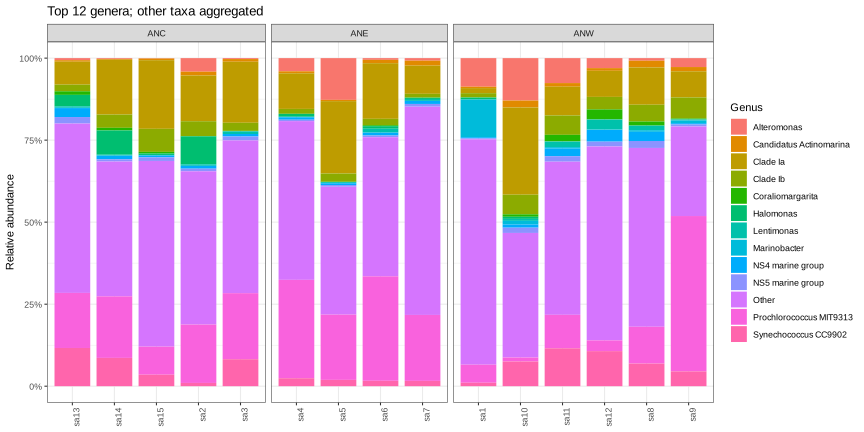

# LAB 01 — Da FASTQ ad ASVFrom FASTQ to ASVs

150 minuti · 100 punti formativi. Apri le missioni in ordine; clicca le figure per ingrandirle.150 minutes · 100 formative points. Open missions in order; click figures to enlarge.

<template data-evidence="0">
Obiettivo: orientarsi nel terminale. Dalla root del progetto usa pwd, ls e file; crea una directory di lavoro. Consulta Bash per pipe e percorsi.Objective: navigate the terminal. From the project root use pwd, ls and file; create a working directory. Consult Bash for pipes and paths.
<pre><code>pwd
ls -lh
mkdir -p results/lab01
ls data-curation/lab01/
cat data-curation/lab01/fastq_inventory.csv</code></pre><a href="bash.html">Bash</a></template>

<template data-evidence="1">
Obiettivo: verificare una coppia autentica prima del processing. Il docente deve fornire le reads dimostrative AmpWrap: i link esistenti sono nel tutorial. Imposta READS sul percorso effettivo, poi confronta ID e conteggi. L’inventario locale attuale non contiene queste reads.Objective: verify an authentic pair before processing. The instructor must provide AmpWrap demonstration reads: existing links are in the tutorial. Set READS to the actual path, then compare IDs and counts. The local inventory currently lacks these reads.
<pre><code>READS=/path/to/ampwrap_demo
ls "$READS"/*fastq.gz
gzip -cd "$READS/S1_10_L001_R1_001.fastq.gz" | head -n 8
gzip -cd "$READS/S1_10_L001_R2_001.fastq.gz" | head -n 8
for fq in "$READS"/*fastq.gz; do
  printf "%s " "$fq"
  gzip -cd "$fq" | awk 'END { print NR/4 }'
done</code></pre><a href="ampwrap.html">AmpWrap</a></template>

<template data-evidence="2">
Obiettivo: confrontare qualità, adattatori e differenze R1/R2. Usa i programmi reali dall’ambiente del corso, senza attivare il replay LAB03. Apri i report HTML dal file manager; annota una metrica e una decisione motivata.Objective: compare quality, adapters and R1/R2 differences. Use real tools in the course environment, without LAB03 replay activation. Open HTML reports in the file manager; record one metric and a justified decision.
<pre><code>command -v fastqc
command -v multiqc
mkdir -p results/lab01/fastqc
fastqc -t 2 -o results/lab01/fastqc "$READS"/*fastq.gz
multiqc results/lab01/fastqc -o results/lab01/multiqc
ls results/lab01/multiqc/</code></pre></template>

<template data-evidence="3">
Obiettivo: seguire Cutadapt → FIGARO → DADA2. Esamina help e workflow nel tutorial; esegui l’analisi lunga solo se indicato dal docente. Primer e lunghezza sotto sono quelli dell’esempio AmpWrap. Individua il report effettivo e confronta numeratore e denominatore in ogni fase di ritenzione.Objective: follow Cutadapt → FIGARO → DADA2. Inspect help and the tutorial workflow; run the long analysis only as directed by the instructor. Primers and length below belong to the AmpWrap example. Locate the actual report and compare numerator and denominator at each retention stage.
<pre><code>ampwrap short --help
ampwrap short -i "$READS" -a GTGYCAGCMGCCGCGGTAA -A CCGYCAATTYMTTTRAGTTT -l 372 -o results/lab01/ampwrap
find results/lab01/ampwrap -type f -name final_report.txt</code></pre><a href="ampwrap.html">AmpWrap workflow / report</a></template>

<template data-evidence="4">
Obiettivo: passare dai risultati di pipeline alla tabella di comunità. Come esempio separato già disponibile, apri SEA4BLUE: confronta conteggi, tassonomia e composizione. Il dataset SEA4BLUE non è presentato come risultato della demo AmpWrap. Nel rapporto distingui reads, ASV e taxa; riporta la ritenzione soltanto se hai il report autentico.Objective: move from pipeline results to a community table. As a separate prepared example, inspect SEA4BLUE counts, taxonomy and composition. SEA4BLUE is not claimed as output of the AmpWrap demo. Distinguish reads, ASVs and taxa in your report; record retention only when an authentic report is available.
<a download href="downloads/Sea4Blue-student.zip">SEA4BLUE ZIP</a> · <a href="data-curation/lab02/analysis_summary.csv">CSV</a></template>

