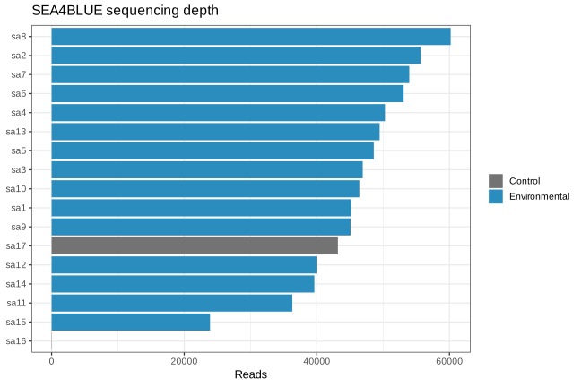
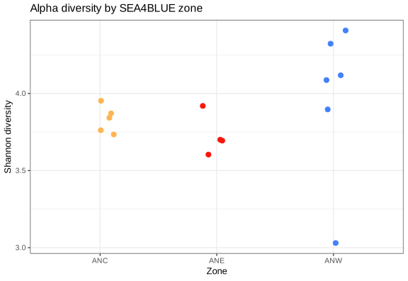
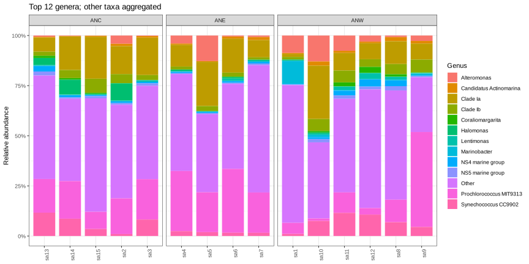
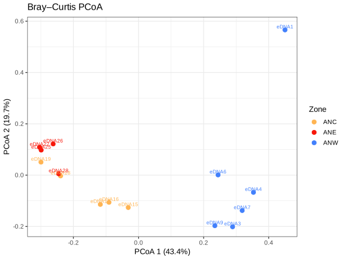

# LAB 02 — Il microbioma atlanticoThe Atlantic Microbiome

150 minuti · 100 punti formativi. Apri le missioni in ordine; clicca le figure per ingrandirle.150 minutes · 100 formative points. Open missions in order; click figures to enlarge.

<template data-evidence="0">
Obiettivo: aprire il dataset in RStudio e distinguere campioni e taxa. Decomprimi lo ZIP una volta. Dalla root del progetto il percorso è materials/Sea4Blue/phyloseq.rds; con lo ZIP scaricato usa invece il percorso estratto.Objective: open the dataset in RStudio and distinguish samples and taxa. Extract the ZIP once. From the project root use materials/Sea4Blue/phyloseq.rds; for the downloaded ZIP use its extracted path.
<a download href="downloads/Sea4Blue-student.zip">SEA4BLUE ZIP</a> · <a href="data-curation/lab02/analysis_summary.csv">CSV</a><pre><code>library(phyloseq)
library(vegan)
ps &lt;- readRDS("materials/Sea4Blue/phyloseq.rds")
nsamples(ps)
ntaxa(ps)
head(data.frame(sample_data(ps)))</code></pre><a href="intro-r.html">R / RStudio</a></template>

<template data-evidence="1">
Obiettivo: confrontare profondità e controlli. Abbina gli ID alla tabella metadati; identifica il controllo negativo prima di interpretare il transetto.Objective: compare depth and controls. Match IDs to metadata; identify the negative control before interpreting the transect.
<pre><code>sample_sums(ps)
meta &lt;- data.frame(sample_data(ps))
summary(sample_sums(ps))
table(meta$Zone, useNA="ifany")</code></pre><a href="data-curation/lab02/sequencing_depth.csv">Depth CSV</a> · <a href="data-curation/lab02/sample_metadata.csv">Metadata CSV</a></template>

<template data-evidence="2">
Obiettivo: distinguere composizione relativa e diversità entro campione. Applica i filtri dello script verificato e confronta la figura Shannon con la composizione.Objective: distinguish relative composition and within-sample diversity. Apply the verified script filters and compare Shannon with composition.
<pre><code>ps_clean &lt;- subset_taxa(ps, (is.na(Family) | Family != "Mitochondria") &amp; (is.na(Order) | Order != "Chloroplast"))
ps_clean &lt;- prune_taxa(taxa_sums(ps_clean) > 1, ps_clean)
ps_clean &lt;- subset_samples(ps_clean, !is.na(Zone))
ps_clean &lt;- prune_taxa(taxa_sums(ps_clean) > 0, ps_clean)
estimate_richness(ps_clean, measures=c("Observed", "Shannon"))</code></pre><a href="data-curation/lab02/alpha_diversity.csv">Alpha CSV</a></template>

<template data-evidence="3">
Obiettivo: calcolare Bray–Curtis e PCoA con la stessa trasformazione del report. Confronta l’ordinamento con la figura preparata; la rotazione degli assi non cambia le distanze.Objective: calculate Bray–Curtis and PCoA with the report transformation. Compare the ordination with the prepared figure; axis rotation does not change distances.
<pre><code>ps_rel &lt;- transform_sample_counts(ps_clean, function(x) x/sum(x))
m &lt;- as(otu_table(ps_rel), "matrix")
if (taxa_are_rows(ps_rel)) m &lt;- t(m)
bray &lt;- vegdist(m, method="bray")
ord &lt;- cmdscale(bray, k=2, eig=TRUE, add=TRUE)
plot(ord$points)</code></pre><a href="data-curation/lab02/pcoa_bray_coordinates.csv">PCoA CSV</a></template>

<template data-evidence="4">
Obiettivo: interpretare effetto, dispersione e limiti ecologici. Confronta il test con il riepilogo validato; scrivi nel rapporto un pattern, due valori e una possibile covariata. Nessuna conclusione libera è valutata automaticamente.Objective: interpret effect, dispersion and ecological limits. Compare your test with the verified summary; report a pattern, two values and a potential covariate. Free-text conclusions are not automatically graded.
<pre><code>meta_rel &lt;- data.frame(sample_data(ps_rel))[rownames(m), , drop=FALSE]
set.seed(42)
adonis2(bray ~ Zone, data=meta_rel, permutations=999)
disp &lt;- betadisper(bray, group=meta_rel$Zone)
set.seed(42)
permutest(disp, permutations=999)</code></pre><a href="data-curation/lab02/analysis_summary.csv">Statistical summary CSV</a> · <a href="scripts/lab02/analyze_lab02.R">Verified R script</a> · <a href="biostatistica.html">Statistics / Statistica</a></template>

