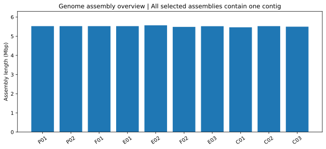
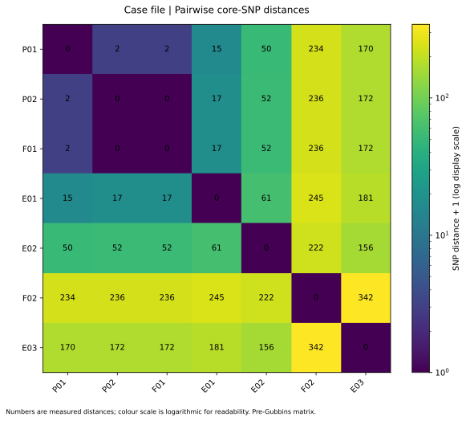
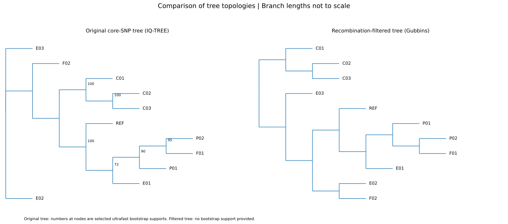

# LAB 03 — Indagine del focolaioOutbreak investigation

150 minuti · 100 punti formativi. Apri le missioni in ordine. Clicca le figure per ingrandirle.150 minutes · 100 formative points. Open missions in order. Click figures to enlarge.

<template data-evidence="0">
Dopo un pasto nello stesso ristorante, due persone segnalano sintomi gastrointestinali. Sono disponibili isolati da pazienti, alimenti e superfici. Formula due ipotesi dal registro senza attribuire ancora una fonte.After a meal at the same restaurant, two people report gastrointestinal symptoms. Patient, food and surface isolates are available. Form two hypotheses from the register without assigning a source yet.
<a href="downloads/lab03/case_samples.csv" download>Registro campioniSample register</a></template>

<template data-evidence="1">
Ispeziona la coppia FASTQ, attiva il replay ed esegui i comandi dalla root del progetto. Apri il report QC e localizza contigs.fasta.Inspect the FASTQ pair, activate replay and run commands from the project root. Open the QC report and locate contigs.fasta.
<pre><code>mkdir -p results
ls ecoli_outbreak/classroom_data/reads/
gzip -cd ecoli_outbreak/classroom_data/reads/CP008805_R1.fastq.gz | head
source tools/classroom-replay/activate.sh
command -v spades.py
fastqc --help
fastqc -o results/qc ecoli_outbreak/classroom_data/reads/CP008805_R1.fastq.gz ecoli_outbreak/classroom_data/reads/CP008805_R2.fastq.gz
spades.py -1 ecoli_outbreak/classroom_data/reads/CP008805_R1.fastq.gz -2 ecoli_outbreak/classroom_data/reads/CP008805_R2.fastq.gz -o results/spades
ls results/spades/</code></pre></template>

<template data-evidence="2">
Obiettivo: distinguere continuità e correttezza. Confronta QUAST e MLST prima di passare agli SNP.Objective: distinguish contiguity and correctness. Compare QUAST and MLST before examining SNPs.
<pre><code>quast.py -o results/quast results/spades/contigs.fasta
less results/quast/report.tsv</code></pre><a href="downloads/lab03/case_quast_summary.csv">QUAST CSV</a> · <a href="downloads/lab03/case_mlst_summary.csv">MLST CSV</a></template>

<template data-evidence="3">
Obiettivo: confrontare distanze e supporti. Leggi la matrice e confronta i due alberi: IQ-TREE riporta bootstrap; Gubbins ha valori di ramo, con scala e filtraggio diversi.Objective: compare distances and support. Read the matrix and compare both trees: IQ-TREE reports bootstrap support; Gubbins has branch values with different filtering and scale.
<a href="downloads/lab03/case_snp_distances.csv">SNP CSV</a></template>

<template data-evidence="4">
Scrivi nel rapporto: ipotesi, due evidenze quantitative, un limite e un dato epidemiologico necessario. La conclusione scientifica è discussa col docente.Write a hypothesis, two quantitative observations, one limitation and a needed epidemiological observation. Discuss your scientific conclusion with the instructor.
</template>

Metodi e provenienzaMethods and provenance

Le FASTQ sono fixture sintetiche indipendenti dagli assembly. Il replay consegna risultati preparati; il report QC è illustrativo e QUAST contiene il confronto completo già validato. I dati del caso sono didattici: gli alias delle figure identificano i campioni del registro.FASTQ files are synthetic fixtures independent of the assemblies. Replay delivers prepared results; QC is illustrative and QUAST contains the full validated comparison. Case metadata are educational; figure aliases identify samples in the register.

