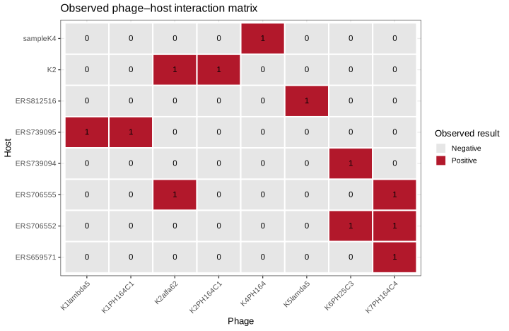

# LAB 04 — La sfida dei fagiThe Phage Challenge

150 minuti · 100 punti formativi. Apri le missioni in ordine. Clicca le figure per ingrandirle.150 minutes · 100 formative points. Open missions in order. Click figures to enlarge.

<template data-evidence="0">
Obiettivo: distinguere test positivo, negativo e non effettuato. Ispeziona righe, colonne e legenda della matrice.Objective: distinguish positive, negative and untested observations. Inspect matrix rows, columns and legend.
<a download href="data-curation/lab04/lab04_host_range_verified.csv">CSV: host–phage panel</a></template>

<template data-evidence="1">
In RStudio, imposta la root del progetto come working directory. Esegui il codice e interpreta i conteggi; i missing non sono zeri.In RStudio set the project root as working directory. Run the code and interpret counts; missing values are not zeros.
<pre><code>x &lt;- read.csv("data-curation/lab04/lab04_host_range_verified.csv", check.names=FALSE)
m &lt;- as.matrix(x[-1])
sum(m == 1, na.rm=TRUE)
sum(m == 0, na.rm=TRUE)
sum(is.na(m))
heatmap(m, Rowv=NA, Colv=NA, scale="none", labRow=x$host_id)
</code></pre></template>

<template data-evidence="2">
Confronta la copertura delle coppie e i match genomici verificati. Non associare sequenze a ID simili senza conferma.Compare pair coverage and verified genome matches. Do not assign sequences to similar IDs without confirmation.
<a href="data-curation/lab04/derived/two_phage_coverage.csv">Pair coverage CSV</a> · <a href="data-curation/lab04/derived/phage_genome_inventory.csv">Genome inventory CSV</a></template>

<template data-evidence="3">
PA14/DMS3 è un sistema distinto da Klebsiella. Leggi lo studio primario e identifica spacer, protospacer, PAM e seed. Distingui DMS3 e DMS3vir.PA14/DMS3 is separate from Klebsiella. Read the primary study and identify spacer, protospacer, PAM and seed. Distinguish DMS3 and DMS3vir.
<a href="https://pmc.ncbi.nlm.nih.gov/articles/PMC3486085/">Cady et al. 2012 — primary study and published figures</a> · <a href="https://www.ncbi.nlm.nih.gov/nuccore/NC_008463.1">PA14</a> · <a href="https://www.ncbi.nlm.nih.gov/nuccore/NC_008717.1">DMS3</a></template>

<template data-evidence="4">
Proponi una coppia motivata dai test, esplicita gli isolati non coperti e due verifiche successive. Il risultato in vitro non dimostra efficacia clinica.Propose a pair supported by the assays, identify uncovered hosts and two follow-up checks. In vitro results do not establish clinical efficacy.
</template>

Metodi e provenienzaMethods and provenance

Matrice PhageHostLearn, Zenodo 11061100 v2, CC BY 4.0. Il subset verificato è completo; nella fonte estesa le celle vuote sono non testate. Le funzioni genomiche non sono state inferite da nomi simili.PhageHostLearn matrix, Zenodo 11061100 v2, CC BY 4.0. The verified subset is complete; blanks in the larger source are untested. Genome functions were not inferred from similar names.

